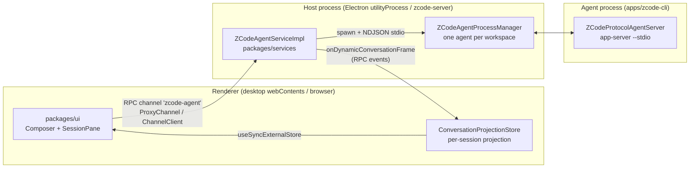
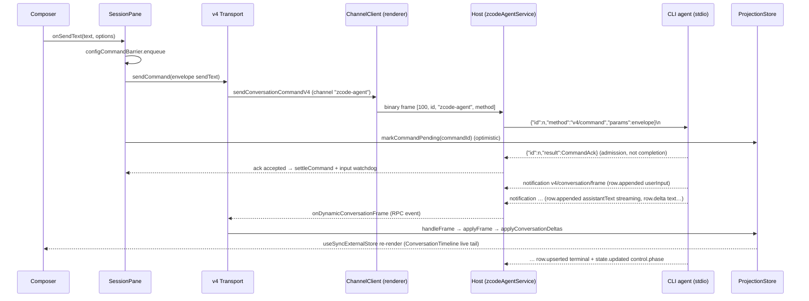

# Client-Side Request Chain: Prompt → Agent → Rendered Response

How a chat prompt travels from the React UI to the agent process, and how the streamed
response comes back and is rendered. Researched against the checked-out source at
`zcode.cjs` v3.14.3 (commit `29628c9`); `file:line` references are anchored there and
will drift as code changes.

Two protocol generations coexist; this document follows the **v4 conversation
protocol** (the live chat path). Legacy paths that are still alive are listed in
[§8](#8-legacy-paths-still-alive).

---

## 1. Big picture: links and owners



| Link | Transport | Set up at |
| --- | --- | --- |
| Renderer ↔ Host (desktop) | Electron `MessagePort` (message-boundary preserving, no framing) | `packages/client/src/messageport.ts:25` (client), `packages/desktop/src/host/index.ts:1986` (server) |
| Renderer ↔ Server (web) | WebSocket with a 13-byte packet header (`SocketProtocol`) | `packages/client/src/websocket.ts:62` (client), `packages/server/src/http.ts:86` (server) |
| Host ↔ Agent CLI | Child process stdio, NDJSON (one JSON object per `\n`-terminated line) | `packages/services/src/zcode-agent/zcodeStdioTransport.ts:81`, spawned in `zcodeAgentProcessManager.ts:1019` |

Everything above the transport is identical for desktop and web: the same
`packages/ui` code, the same RPC channel framework (`packages/rpc`), the same service
implementations (`packages/services`). What differs is who hosts the services
(Electron utilityProcess vs `zcode-server`) and the trust profile attached to the
connection (see [§7](#7-desktop-vs-web)).

### The RPC framework in one paragraph

Services are addressed by channel name (a `ServiceDescriptor`, e.g. `IZCodeAgentService`
→ `"zcode-agent"`, defined in `packages/services/src/zcode-agent/zcodeAgent.ts:864`).
On the host side `ServiceCollection.exposeOnChannelServer` wraps each service with
`ProxyChannel.fromService` (`packages/rpc/src/proxy-channel.ts:46`); on the renderer
side `ProxyChannel.toService` returns an ES6 `Proxy` where every method call becomes
`ChannelClient.call(method, args)` — serialized as a binary frame
`[RequestType.Promise=100, id, channelName, methodName] + body`
(`packages/rpc/src/channelClient.ts:54`, wire enums in `channels.shared.ts:18`) and
correlated by the numeric `id` echoed in the response. Methods named `onDynamic*`
become parameterized event subscriptions (`proxy-channel.ts:126`) — that is how
streaming frames cross this boundary.

---

## 2. Sending a prompt

### 2.1 Composer: keystroke to `onSendText`

- `packages/ui/src/LexicalChatInput.tsx:536` — `KEY_ENTER_COMMAND` handler; after
  IME/disable gates it calls the `onSubmit(text)` prop. The input component is a dumb
  shell; it never touches services.
- `packages/ui/src/v4/ConversationComposer.tsx:1495` — `handleEditorSubmit` funnels
  Enter and the send button into the single `submit` callback
  (`ConversationComposer.tsx:1142`). `submit` serializes mentions into plain text, then
  hands off:

  ```ts
  const sendResult = await onSendText(promptText, { submission, telemetrySeed, attachments, ... });
  // ConversationComposer.tsx:1345
  ```

  `requestedDelivery` (`"startNow" | "queue" | "guide"`) and `heldQueueDisposition`
  ride along in the same options object (`ConversationComposer.tsx:175`).

### 2.2 SessionPane: orchestration and admission guards

`onSendText` is `handleSendText` in `packages/ui/src/v4/SessionPane.tsx:2962`. The
Zustand `useZCodeSessionStore` has **no send action** — it holds workspace/task UI
state only. Sending is orchestrated in `SessionPane`:

1. `dispatchSendText` (`SessionPane.tsx:2921`) enqueues the send behind
   **`configCommandBarrier`** (`v4/configCommandBarrier.ts:12`), a promise chain that
   prevents a `sendText` from overtaking an in-flight model/mode CAS update.
2. `dispatchSendTextAfterConfig` (`SessionPane.tsx:2520`) is the decision tree:
   - slash command → `dispatchSlashCommand`;
   - existing session, plain text →
     `dispatchSubmissionCommand("sendText", { text, ...submission, attachments?, requestedDelivery?, heldQueueDisposition?, context_refs? }, sessionId)`
     (`SessionPane.tsx:2863`);
   - no session yet → new-session flow ([§3](#3-starting-a-new-session-draft-first-send)).
3. **Busy/queue admission is confirmed by the CLI, not the renderer.** If the session's
   `inputRouting.mode` is `choice` (agent busy with queued input), the send returns
   `"confirmationRequired"` (`SessionPane.tsx:2608`), the composer asks the user to
   clear or keep the queue, and resubmits with `heldQueueDisposition:
   "clearQueueAndSend" | "keepQueueAndSend"` plus frozen `expectedHeldQueueItemIds`.
   The CLI's `CommandInbox` performs the actual serial admission and can answer
   `guard.heldQueueConfirmationStale` (`SessionPane.tsx:2886`) if the queue changed
   under the confirmation.

### 2.3 The command envelope

`dispatchCommand` (`SessionPane.tsx:1395`) wraps the payload with
`createCommandEnvelope` (`v4/commandFactory.ts:51`):

```ts
{ commandId: uuidv7(),        // client-minted, idempotency key
  clientId,                   // stable per-renderer id, persisted in localStorage
  sessionId | null, type: "sendText", payload, issuedAt }
```

The payload schema is `commandPayloadSchemas.sendText`
(`packages/shared/src/zcode-protocol-v4/command.ts:81`). The envelope is validated
together with its payload by `parseCommandEnvelope` (`command.ts:340`).

### 2.4 Optimistic state (what the renderer shows before any server fact)

- The envelope is recorded in `pendingCommandRegistry` (`SessionPane.tsx:1428`) — a
  recovery ledger consulted on renderer refresh.
- The projection store marks it pending: `markCommandPending`
  (`v4/conversationProjectionStore.ts:1232`). Optimistic commands **never fabricate
  message rows**; they only overlay "command in flight" until the authoritative
  `row.appended` for the user input arrives.
- `expectAcceptedInputProjection` (`conversationProjectionStore.ts:1247`) arms a
  watchdog: if an accepted `sendText` never shows up in the projection within ~2s,
  same-subscription recovery is triggered (rather than replaying the command).
- Task-list sidebar gets `upsertOptimisticTaskListItem`
  (`store/zcodeSessionStoreTaskSlice.ts:792`) so a new task appears before the index
  syncs.

### 2.5 v4 transport and handshake

`sendCommand` in `useV4Conversation()` resolves to
`v4/agentConversationTransport.ts:350`:

```ts
async sendCommand(envelope) {
  const hello = await ensureHandshake();   // helloConversationV4 + initializeConversationV4
  ...
  return agentService.sendConversationCommandV4({ ...workspace, envelope });
}
```

The one-time handshake (`v4/agentV4ConnectionHandshake.ts:19`) exchanges
`hello`/`clientHello` (`zcode-protocol-v4/transport.ts:41`), which is where the
renderer learns its `clientMode` (`desktop-continuous` vs `web-remote-replayable`)
and host capabilities (e.g. `independentPlanState`, checked at
`agentConversationTransport.ts:358` before sending plan-related payloads).

### 2.6 Across the RPC boundary

`agentService` is a `ProxyChannel.toService` proxy built by `RemoteServiceAccess`
(`packages/client/src/remoteServiceAccess.ts:135`). The call becomes one binary frame
on channel `"zcode-agent"` and lands in the host process. On desktop the host wraps
the real agent service in a **connection scope**
(`zcode-agent/zcodeAgentConnectionScope.ts:702`) that validates the handshake and
injects the trusted `clientMode` carrier — a renderer cannot lie about who it is.

### 2.7 Host service: `sendConversationCommandV4`

`packages/services/src/zcode-agent/zcodeAgentService.ts:5044`:

1. `getClient(params)` obtains the per-workspace agent client, **spawning the CLI if
   needed** (`zcodeAgentProcessManager.ts:1019` — `spawn(cmd, ["app-server",
   "--stdio"], { stdio: ["pipe","pipe","pipe"] })`; one process per workspace key,
   `getClient` at `:832`). Provider-not-ready is rejected here, before any RPC.
2. Envelope enrichment (`buildConversationCommandEnvelope`, `:3281`): injects
   tool denylists for automation/off-peak runs, feature flags on `createSession`.
3. Untrusted fields are stripped: top-level `clientMode` is replaced by the trusted
   connection value (`:5060`); local-only TTFT fields are removed for anything that is
   not trusted desktop-local (`:5075`).
4. `sendText` gets browser ambient context injected when a browser session is active
   (`:5083`).
5. Final call:

   ```ts
   const ack = await client.request(V4_METHODS.command /* "v4/command" */, envelope, commandAckSchema);
   // zcodeAgentService.ts:5102
   ```

### 2.8 Wire format to the agent

`ZCodeProtocolClient.request` (`zcode-agent/zcodeProtocolClient.ts:134`) assigns a
monotonic `id`, keeps a `PendingRequest` (default 3-minute timeout), and sends
`{ id, method: "v4/command", params: envelope }`. `ZCodeStdioTransport.send`
(`zcodeStdioTransport.ts:81`) writes exactly one line:
`` `${JSON.stringify(message)}\n` `` to the child's stdin. The CLI side
(`apps/zcode-cli/packages/bootstrap/src/zcode-protocol/`) reads LF-delimited lines and
dispatches in `ZCodeProtocolAgentServer`. There is no handshake on this link; the
optional startup gate is the `startup/storageState` notification.

### 2.9 The ACK

The `CommandAck` (`zcode-protocol-v4/command.ts:430`) is
`{ commandId, status: accepted | rejected | stale | duplicate | noop | failed,
reasonCode?, revisionAtDecision, result? }` — e.g. `result.type === "inputAccepted"`
with `delivery` and `inputId`. Back in the renderer, `applyAck`
(`SessionPane.tsx:1497`) settles the optimistic overlay (`settleCommand`,
`conversationProjectionStore.ts:1283`); `accepted`/`duplicate` also arms the
accepted-input watchdog. **The ACK is admission, not completion** — the actual
conversation content arrives on the frame stream below.

---

## 3. Starting a new session (draft first send)

- The composer pre-warms a session: `useDraftSessionPrewarm`
  (`v4/composer/useDraftSessionPrewarm.ts:462`) issues an empty `createSession`
  command as soon as the draft is focused, so a session id (`ack.result.sessionId`)
  already exists before the user types.
- On first send, `dispatchSendTextAfterConfig` prefers the prewarmed session
  (`SessionPane.tsx:2739`) and promotes it on acceptance
  (`handleDraftSessionCreated`, `SessionPane.tsx:1313` → `promoteComposerDraft` +
  `onSessionCreated`, which switches the workspace's `activeTaskId`).
- Without prewarm: `createSession` carrying `firstInput` (no attachments), or empty
  `createSession` followed by `sendText` (`SessionPane.tsx:2792`–`2860`). Transport
  errors at this point are treated as unknown-admission and are never auto-retried on
  a fresh session.

---

## 4. Processing the response

The renderer never consumes raw model deltas. The CLI publishes **topic frames** —
snapshot + delta operations over `ConversationRow`s — and each renderer session
maintains a projection of them.

### 4.1 Agent → host: `v4/conversation/frame` notifications

The CLI pushes `V4_NOTIFICATIONS.conversationFrame` (`"v4/conversation/frame"`,
`zcode-protocol-v4/transport.ts:407`) over the same stdio link. Physical frames
(`TopicWireFrame`, `zcode-protocol-v4/wire.ts:19`) may be fragmented (base64
fragments with crc32, reassembled by `topicWireDecoder.ts:22` on the renderer side).
The host's `client.onNotification` (`zcodeAgentService.ts:2060`) demuxes by topic
prefix (`sessions-index/…`, `workspace-config/…`, else conversation topics) onto
per-workspace emitters, exposed to the renderer as the dynamic RPC event
**`onDynamicConversationFrame`** (`zcodeAgentService.ts:5473`). The subscription
itself (`v4/conversation/subscribe`) was established when the session pane acquired
its lease; the ACK carries the `subscriptionId` that all subsequent frames must match.

### 4.2 Host → renderer: into the projection store

- `agentConversationTransport.onFrame` (`agentConversationTransport.ts:527`) attaches
  `agentService.onDynamicConversationFrame(workspace)` (`:546`). Pre-ACK frames wait
  in an activation barrier until the subscribe ACK's `subscriptionId` is known.
- `SessionDataLayer` (`v4/sessionDataLayer.ts:62`) fans frames in by topic to the
  owning store.
- `ConversationProjectionStore.handleFrame` (`v4/conversationProjectionStore.ts:601`)
  is the single entry point: drops frames from stale subscriptions (`:608`), routes
  delivery kinds (initial / online / recovery), and calls `applyFrame`.

### 4.3 Projection rules (`conversationProjectionStore.ts:2`)

1. A **snapshot** frame replaces the whole state — never merged.
2. A **deltas** frame applies only if `frame.fromSeq === current.seq` (interval
   `(fromSeq, toSeq]`). On a gap the store does not guess: it resubscribes carrying
   the current watermark as `base` (`:424`) and the server adjudicates `resume` vs
   fresh `snapshot`; a same-subscription `v4/conversation/resync` recovery path
   exists for repairable gaps (`requestRecovery`, `:803`).

### 4.4 Delta operations and message assembly

The pure reducer is `applyConversationDeltas` (`zcode-protocol-v4/apply.ts:68`) with a
closed set of ops (`zcode-protocol-v4/delta.ts:94`):

| Op | Effect |
| --- | --- |
| `row.appended` | new row appended to `snapshot.rows.window` |
| `row.upserted` | whole-row replacement (status transitions, final commit) |
| `row.removed` | truncate branch from `fromRowId` (edit / retry) |
| `row.delta` | streaming append on a path: `text`, `inputText`, `output.text`, `summaryText` |
| `state.updated` | key-level snapshot patch: `control`, `queue`, `pendingInteractions`, `usage`, `plan`, … |
| `workflowRun.updated/removed` | dynamic-workflow runs |

A model reply is assembled like this: `row.appended` of an `assistantText` row in
`state: "streaming"` → repeated `row.delta { path: "text" }` appends → a `row.upserted`
committing the row in a terminal state (`complete | interrupted | failed`,
`zcode-protocol-v4/rows.ts:162`). Tool calls go `toolCall` row with
`status: "inputStreaming"` (input JSON accumulated via `path: "inputText"`) →
`running` → `success | error | cancelled`. There is no client-side synthesis of a
"result message": completion is `control.phase` + terminal row states, and turn
boundaries are `turnHeader` rows (`rows.ts:77`). Row kinds: `turnHeader, userInput,
assistantText, reasoning, toolCall, artifact, subagent, hookInvocation,
timelineMarker` (`rows.ts:420`).

### 4.5 Rendering

`useConversationProjection` (`v4/useConversationProjection.ts:19`) is a
`useSyncExternalStore` over the projection store. `ConversationTimeline`
(`v4/ConversationTimeline.tsx:352`, mounted from `SessionPane.tsx:4735`) builds turn
render units, renders history in a virtualized list, and splits the streaming last
turn into a non-virtualized live tail (`conversationTimelineLiveTail.ts:15`).
"Running" is derived from `turnHeader.state === "running"` with a fallback over
in-flight rows (`conversationTurnRenderUnits.ts:199`). The Zustand session store is
updated separately for chrome-level state (task status, usage, api-retry badges —
`setTaskRuntimeState` etc. in `store/zcodeSessionStoreTaskSlice.ts:200`).

---

## 5. Permission and elicitation: the interaction loop

Interactions are **not** separate events — they arrive as `state.updated` patches of
`snapshot.pendingInteractions` (schema `zcode-protocol-v4/snapshot.ts:312`; a
`toolCall` row points at its item via `approvalInteractionId`). `V4InteractionDialogs`
(`v4/V4InteractionDialogs.tsx:92`, mounted from `SessionPane.tsx:4544`) picks the
pending item and renders `PermissionDialog` / `ElicitationDialog`. The user's answer
goes back as an ordinary command: `resolveInteraction` envelope →
`sendCommand` → `v4/command` (`V4InteractionDialogs.tsx:191`). The same
`pendingInteractions` list is how remote (phone) responses land.

---

## 6. Reconnect and recovery

- **Watermark-based resume.** Every projection carries `{ logEpoch, seq }`. On gap or
  reconnect the store resubscribes with that base; the server answers `resume` (delta
  frames from the watermark) or `snapshot` (full replace). Same-subscription gaps use
  `v4/conversation/resync` first, escalating to a forced snapshot; assembly faults and
  runtime restarts skip straight to snapshot (`handleRuntimeRestart`,
  `conversationProjectionStore.ts:964`).
- **Command reconciliation.** After a reconnect the renderer replays its
  `pendingCommandRegistry` through `v4/commands/query`
  (`zcodeAgentService.ts:5111`; renderer side `usePendingCommandRecovery`,
  `SessionPane.tsx:2373`) to learn which in-flight commands the CLI actually
  admitted, instead of blindly re-sending.
- **Delivery profiles.** `desktop-continuous` is the trusted local link (TTFT
  instrumentation, continuous stream). `web-remote-replayable` is the phone/remote
  profile: frames must be replayable after reconnect, the input `queue` is
  deliberately not persisted across CLI restarts (`snapshot.ts:208` — the client
  reconciles and the user decides whether to re-send), and owner commands like
  `promote_task_command` are restricted to this mode (`shared/src/task-realtime.ts:145`).

---

## 7. Desktop vs web

Same upper stack; differences sit at the edges:

| Aspect | Desktop | Web |
| --- | --- | --- |
| Renderer ↔ services | `MessagePort` transferred through preload (`desktop/src/preload/index.ts:831` → `renderer/src/main.tsx:305`) | WebSocket `/ws` (`web/src/main.tsx:446` → `client/src/websocket.ts:62`) |
| Services hosted by | Host utilityProcess forked by main (`desktop/src/main/desktopHostProcess.ts:257`) | `zcode-server` (`packages/server/src/http.ts` / `stdio.ts`) |
| `clientMode` | `desktop-continuous` | `web-remote-replayable` (attached per-connection by the connection scope, `http.ts:96`) |
| Agent process | Spawned by host on the local machine | Spawned by the server on the machine hosting it — same `createLocalServices` path |
| Remote workspaces | Host proxies services over SSH/WSL stdio with a `zcode-hello` handshake (`server/src/remote/connect.ts:204`; this handshake is *not* used on the agent link) | `/ws/remote/:id` relays (`http.ts:417`) |

## 8. Legacy paths still alive

- **`session/send` (v3)** — `zcodeAgentService.sendPrompt`
  (`zcodeAgentService.ts:4430`), still used by the background-task adapter when a
  prompt carries attachments (`zcode-agent/zcodeTaskServiceAdapter.ts:419`); plain
  text there also goes through v4 `sendText`.
- **`ZCodeStreamEvent` raw events** (`shared/src/zcode-task-types-core.ts:432`:
  `agent_message_chunk`, `tool_call`, `permission_request`, …) — consumed today by the
  bots service and the mobile replayable mirror (`taskServiceAdapter.onDynamicTaskEvent`,
  `zcodeTaskServiceAdapter.ts:3083`); the session service no longer subscribes
  (`zcode-session/zcodeSessionService.ts:490`). The legacy event vocabulary and its
  persisted-parts merge (`zcodePersistedMessageMerge.ts`) exist for snapshot restore
  of older sessions.
- **`packages/ui/src/replay.ts`** — read-only browser replay harness barrel; not part
  of the live chain.

---

## Appendix: end-to-end sequence (existing session, desktop)


